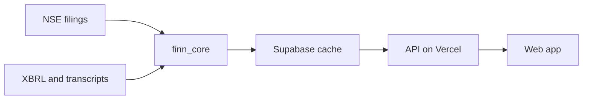
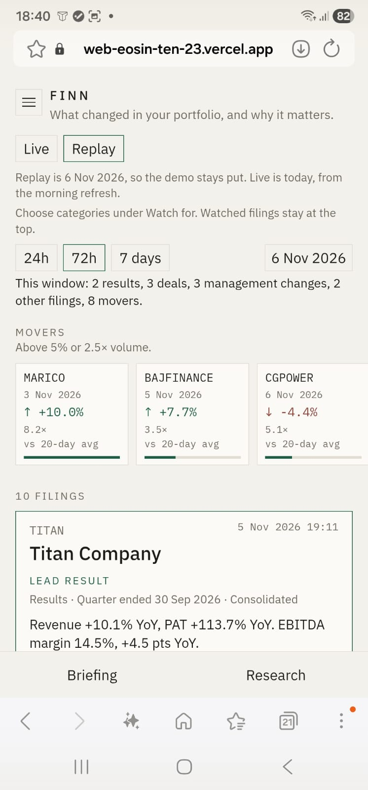
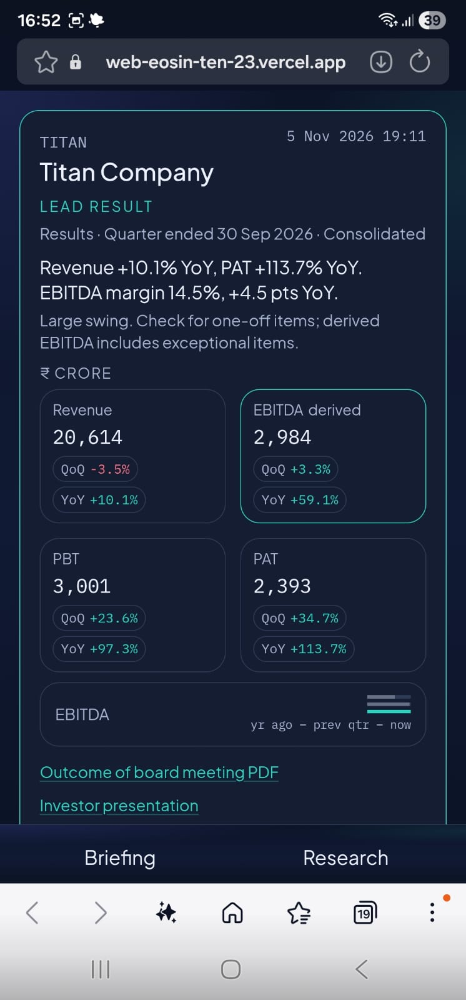
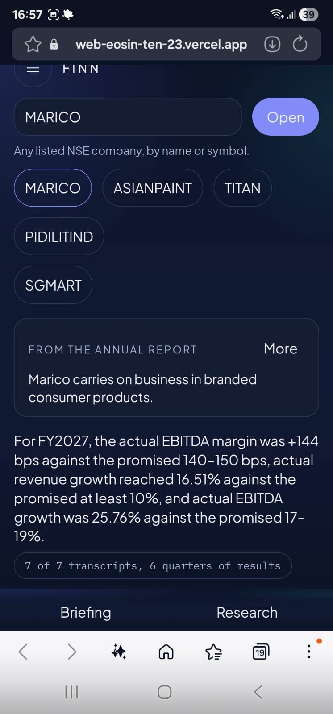

# FINN

FINN is a phone-first investor app with two modes.

**Push** tells you what changed. The demo opens on a 72-hour replay of 6 Nov 2026. Live defaults to the last 24 hours. Material filings come first, and routine ones collapse into one row. Watch for pins chosen filing types to the top. Live and Replay switch the day. Price and volume alerts use thresholds you set.

**Pull** is the Research tab. Type any NSE company. Each briefing card, and each mover sheet, has a Research this company button. It opens Research with that company already entered and starts the ledger. A cached company opens at once. You then see what the company does, the promise ledger, a six-quarter trend, numbers at a glance, the balance sheet, and cash quality.

Live app: https://web-eosin-ten-23.vercel.app

API: https://finn-r4y3.vercel.app

## Try it

Open the app. It is the 6 Nov replay. Tap the Titan results card, then press Research this company. Try MARICO for a result that is already stored. Try WIPRO for a first run. That takes about one to two minutes. If the free daily limit is reached, cached companies still open.

## How it works



NSE announcements, integrated-filing XBRL, annual reports and transcripts are read by `finn_core`. Prices are end-of-day from Yahoo Finance. Extracted text and model output are cached by ticker, document and quarter. The API is one Python function in Mumbai. The web app is a Vite PWA. If Supabase is paused, a stored feed or ledger is served from `data/snapshot`.

## Decisions

- **NSE is the primary source.** BSE does not answer from the Vercel region. The spike in `/spike` is the check.
- **XBRL first.** Quarterly figures, the balance sheet and cash flow come from the tagged filing. The model is the fallback for prose, not for a number the tag already states.
- **Derived EBITDA and EBIT.** EBITDA is derived and excludes other income. An unqualified "operating margin" is read as both EBIT and EBITDA. It is scored only when both readings agree. Otherwise the row shows as definition ambiguous, with both numbers.
- **Verify before scoring.** The verifier checks four things: consolidated scope, a reported basis rather than constant currency, independence from a named event, and that the metric is named. A failed check is not scored, and the row says why in plain words. Only the latest guidance is scored. A unit check rejects a figure in the wrong unit. The period has to be named. A borderline band sits near the edge for derived margins.
- **The ledger reads the calls.** Guidance comes from the last seven earnings calls.
- **Precision over recall.** A sentence in the annual-report note stays only when six of its own words are on the page it cites. A missing tag is shown as not available.
- **Free-tier routing.** Bulk extraction uses a fast Gemini model. Promise-versus-delivery uses a stronger one. A Gemini 429 falls through to Groq. Cached companies still open after the daily limit.
- **Replay, snapshots, and a morning job.** The demo is a 72-hour replay of 6 Nov 2026. Live defaults to 24 hours. `data/snapshot` holds finished ledgers and feeds. A cron at 09:00 IST refreshes today's 24-hour and 72-hour feeds. The cron route rejects a call that does not carry the secret.

## Efficiency

From the prewarm on 11 Nov 2026. Detail is in `BUILD_LOG.md`.

- 59 ledgers completed. `data/snapshot` has 60 ledger files, about 1.4 MB, including Wipro, which was already a demo ledger.
- 50 cold ledgers averaged 56.0 seconds.
- About 21k tokens per cold ledger.
- The 6 Nov replay has 2 results cards in the 72-hour window, both from XBRL, and the feed used 0 tokens.
- Balance sheet and cash quality are computed from the tags. They add no model tokens.

## Limitations

- **Accuracy over coverage.** 9 of the 59 ledgers have a scored row, 18 rows in all. The other 50 have none. A check that fails stays unscored.
- The live filing path is NSE. BSE is not called in production.
- The morning job and a cold ledger depend on the free-tier quota. After the daily limit, only cached companies open.
- Supabase's free project can pause. The snapshot files cover a stored feed or a finished ledger, not a ticker that has never been opened.
- Cash quality uses the half-year cash-flow statement. Inventory and working-capital timing can swing it. The card says so.
- Debt-to-equity, working capital, cash conversion and free cash flow are not meaningful for a bank, NBFC or insurer, because borrowings and operating cash flow are the business.
- Net debt subtracts cash, other bank balances and current investments. If either extra tag is missing, the figure is labelled partial.
- The annual-report note will drop a true sentence that the model did not phrase with six consecutive words from the page.

## Left out

Bull versus bear. An "ask about this" chat. Real phone notifications. BSE as a second source. Scoring of constant-currency or segment guidance. Voice, a native app, and accounts.

## Next

An ask-about-this chat on the card you are reading. Bull and bear from the same filings. Phone notifications. BSE, if a public endpoint answers from the host.

## Screenshots







## Run locally

The web app talks to the deployed API. From `web/`:

```bash
npm install
npm run dev
```

`web/.env` needs `VITE_API_BASE`. See `web/.env.example`.

Python tests, from the repo root, with the dependencies in `pyproject.toml`:

```bash
python -m unittest discover -s tests
python scripts/smoke_test.py
```

Environment names, and no others, are listed in `.env.example`:

- `GEMINI_API_KEY`
- `GROQ_API_KEY`
- `SUPABASE_URL`
- `SUPABASE_SECRET_KEY`
- `CACHE_BACKEND`
- `CRON_SECRET`

Put values in `.env`, which is gitignored, or in the Vercel project. `CACHE_BACKEND=supabase` is set on the API project. `CRON_SECRET` is set there too. Neither belongs in the web app.
