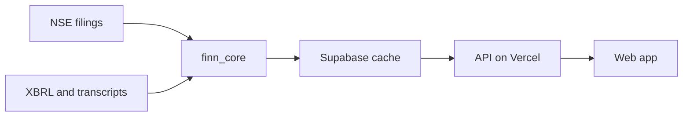

# FINN

FINN is a phone-first investor app with two modes.

**Push** opens on what changed. A portfolio digest for a chosen window (the default is the last 24 hours) puts material filings first and collapses the routine ones. Price and volume alerts use thresholds the investor sets.

**Pull** starts from that item, not from an empty chat. Research shows what the company does, the promise ledger (the last four quarters of guidance against what was delivered), a small financial snapshot, the balance sheet, and cash quality.

Live app: https://web-eosin-ten-23.vercel.app

API: https://finn-r4y3.vercel.app

## How it works



NSE announcements, integrated-filing XBRL, annual reports and transcripts are read by `finn_core`. Prices are end-of-day from Yahoo Finance. Extracted text and model output are cached by ticker, document and quarter. The API is one Python function in Mumbai. The web app is a Vite PWA. If Supabase is paused, a stored feed or ledger is served from `data/snapshot`.

## Decisions

- **NSE is the primary source.** BSE does not answer from the Vercel region. The spike in `/spike` is the check.
- **XBRL first.** Quarterly figures, the balance sheet and cash flow come from the tagged filing. The model is the fallback for prose, not for a number the tag already states.
- **Derived EBITDA and EBIT.** EBITDA is derived and excludes other income. An operating-margin promise is scored as EBIT. A definition that does not match is left unscored.
- **Verify before scoring.** A guidance row is kept only when the quoted passage is in the filing, and the score uses that passage.
- **Precision over recall.** A sentence in the annual-report note stays only when six of its own words are on the page it cites. A missing tag is shown as not available.
- **Free-tier routing.** Bulk extraction uses a fast Gemini model. Promise-versus-delivery uses a stronger one. A Gemini 429 falls through to Groq. Cached companies still open after the daily limit.
- **Replay, snapshots, and a morning job.** Replay is fixed on 6 Nov 2026 so a demo does not move. `data/snapshot` holds finished ledgers and feeds. A cron at 09:00 IST refreshes today's 24-hour and 72-hour feeds. The cron route rejects a call that does not carry the secret.

## Efficiency

From the prewarm on 11 Nov 2026. Detail is in `BUILD_LOG.md`.

- 59 ledgers completed. `data/snapshot` has 60 ledger files, about 1.4 MB, including Wipro, which was already a demo ledger.
- 50 cold ledgers averaged 56.0 seconds.
- The 18 cold ledgers whose log summed every stage used 386,337 tokens, 21,463 each.
- The 6 Nov replay has 2 results cards in the 72-hour window, both from XBRL, and the feed used 0 tokens.
- 9 of the 59 ledgers have a scored row (18 rows). 50 have none.
- Balance sheet and cash quality are computed from the tags. They add no model tokens.

## Limitations

- The live filing path is NSE. BSE is not called in production.
- The morning job and a cold ledger depend on the free-tier quota. After the daily limit, only cached companies open.
- Supabase's free project can pause. The snapshot files cover a stored feed or a finished ledger, not a ticker that has never been opened.
- Cash quality uses the half-year cash-flow statement. Inventory and working-capital timing can swing it. The card says so.
- Debt-to-equity, working capital, cash conversion and free cash flow are not meaningful for a bank, NBFC or insurer, because borrowings and operating cash flow are the business.
- Net debt subtracts cash, other bank balances and current investments. If either extra tag is missing, the figure is labelled partial.
- The annual-report note will drop a true sentence that the model did not phrase with six consecutive words from the page.

## Left out

Trajectory, bull and bear cases, and the other pull write-ups. Voice, a native app, accounts, and real-time prices. Enrichment of every announcement type: results and management changes are the cards that get the extra lines. Everything else is a one-line summary or a priority.

## Next

Score more of the guidance that is already extracted. Add the trajectory and bull/bear notes from the same filings. Bring BSE in if a public endpoint answers from the host. Accounts, once a person has more than one portfolio.

## Run locally

The web app talks to the deployed API. From `web/`:

```bash
npm install
npm run dev
```

`web/.env` needs `VITE_API_BASE`. See `web/.env.example`.

Python tests, from the repo root, with the dependencies in `pyproject.toml`:

```bash
python -m unittest discover -s tests
python scripts/smoke_test.py
```

Environment names, and no others, are listed in `.env.example`:

- `GEMINI_API_KEY`
- `GROQ_API_KEY`
- `SUPABASE_URL`
- `SUPABASE_SECRET_KEY`
- `CACHE_BACKEND`
- `CRON_SECRET`

Put values in `.env`, which is gitignored, or in the Vercel project. `CACHE_BACKEND=supabase` is set on the API project. `CRON_SECRET` is set there too. Neither belongs in the web app.
